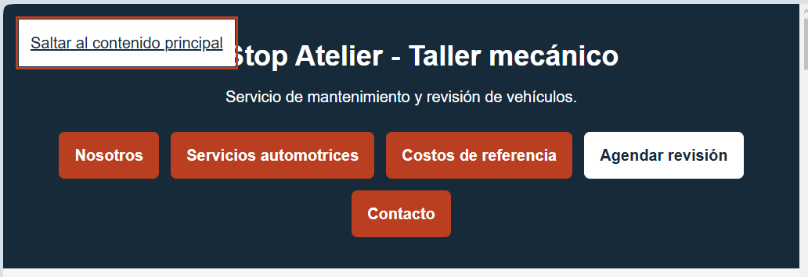
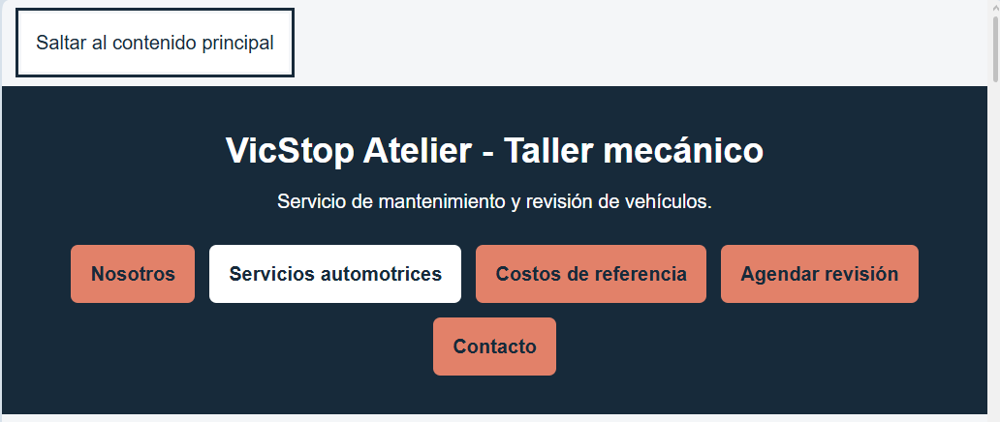

# RESPUESTA A LA AUDITORÍA – PARTE 3

**Página web:** VicStop Atelier  
**Desarrolladora:** Victoria Andrade  
**Repositorio:** [andrade-victoria-ESTANDARES-HTML](https://github.com/VictoriaAndradeV/andrade-victoria-ESTANDARES-HTML)

## Análisis de la auditoría recibida

Mi compañero auditor revisó ocho requisitos de la página web y no reportó incumplimientos. Sin embargo, durante una revisión adicional se identificaron problemas que no fueron detectados en su evaluación.

Se aceptan las observaciones correspondientes a los requisitos 1, 2, 3, 6, 7 y 8. Se refutan parcialmente los puntos 4 y 5 debido a la superposición del enlace de accesibilidad. Además, se documenta un hallazgo propio relacionado con el contraste de colores.

## Tabla de respuesta y correcciones

| N.º de hallazgo | Decisión (acepto o refuto) | Justificación con la norma | Evidencia antes y después | Commit |
|---|---|---|---|---|
| **N.º 1, 2, 3, 6, 7 y 8** | **Aceptar** | Se aceptan las observaciones sobre estructura HTML, formulario, tabla, validación HTML, validación CSS y ficha personalizada, ya que el auditor no reportó incumplimientos en estos requisitos. | Informe de auditoría recibida y evidencias proporcionadas por el compañero. | No aplica |
| **N.º 4: Diseño adaptable** | **Refutar parcialmente y corregir** | El auditor indicó que la página funcionaba correctamente a 360 px. Sin embargo, durante la navegación por teclado se observó que el enlace «Saltar al contenido principal» se superponía al encabezado. Se modificó `position: absolute` por `position: static` al recibir el foco. La corrección mejora la adaptación del contenido y se relaciona con WCAG 2.2, criterio **1.4.10 (Reflow, nivel AA)**. La superposición observada no demuestra por sí sola un incumplimiento de dicho criterio. | **Antes:** enlace superpuesto al título. **Después:** enlace visible sin superposición. | [`2ac0f63`](https://github.com/VictoriaAndradeV/andrade-victoria-ESTANDARES-HTML/commit/2ac0f63) |
| **N.º 5: Navegación con teclado** | **Refutar parcialmente y corregir** | El auditor confirmó que los elementos podían recorrerse con `Tab` y mostraban el indicador de foco. Aunque esto era correcto, el enlace de accesibilidad se superponía al título cuando recibía el foco. Se corrigió su posicionamiento para mejorar su presentación. La mejora se relaciona con WCAG 2.2, criterio **2.4.7 (Focus Visible, nivel AA)**, sin que la superposición implique necesariamente el incumplimiento de este criterio. | **Antes:** enlace enfocado sobre el encabezado. **Después:** enlace enfocado en su propio espacio. | [`2ac0f63`](https://github.com/VictoriaAndradeV/andrade-victoria-ESTANDARES-HTML/commit/2ac0f63) |
| **AD-01: Contraste de colores (hallazgo propio)** | **Aceptar y corregir** | Se detectó que la combinación del naranja `#D14E2E` con texto blanco tenía un contraste de **4.34:1**, inferior al mínimo de **4.5:1** exigido por WCAG 2.2, criterio **1.4.3 (nivel AA)** para texto normal. Se implementó `#E28169` con texto `#172A3A` (5.30:1) y `#AA4328` con texto blanco (5.93:1), cumpliendo el contraste requerido. | **Antes:** colores originales y comprobación del contraste. **Después:** nueva paleta y resultados del verificador. | [`2ac0f63`](https://github.com/VictoriaAndradeV/andrade-victoria-ESTANDARES-HTML/commit/2ac0f63) |

## Evidencias de las correcciones

### AD-01: Contraste de colores y N.º 4 y 5: Accesibilidad

**Antes de las correcciones:**

**Después de las correcciones:**

## Referencias normativas

- [WCAG 2.2 – Criterio 1.4.3: Contraste mínimo (AA)](https://www.w3.org/WAI/WCAG22/Understanding/contrast-minimum)
- [WCAG 2.2 – Criterio 1.4.10: Reflow (AA)](https://www.w3.org/WAI/WCAG22/Understanding/reflow)
- [WCAG 2.2 – Criterio 2.4.7: Foco visible (AA)](https://www.w3.org/WAI/WCAG22/Understanding/focus-visible)

## Conclusión
La auditoría recibida no reportó incumplimientos. Sin embargo, en mi revisión pude identificar aspectos que no fueron detectados por el compañero auditor. Por esta razón, se refutaron parcialmente las observaciones sobre diseño adaptable y navegación con teclado. Adicionalmente, corregí un problema de contraste de colores para cumplir con WCAG 2.2, nivel AA. Las modificaciones quedaron registradas en el commit `2ac0f63`.
